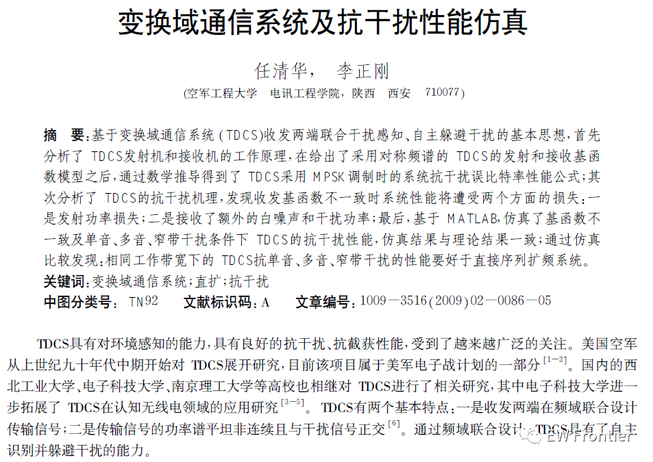
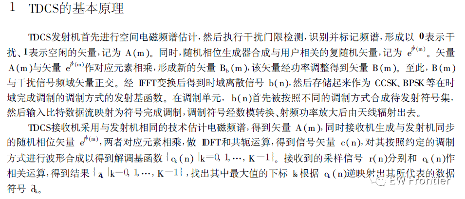
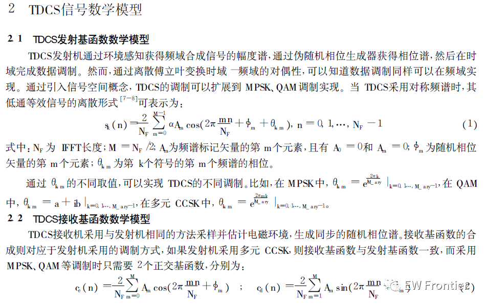
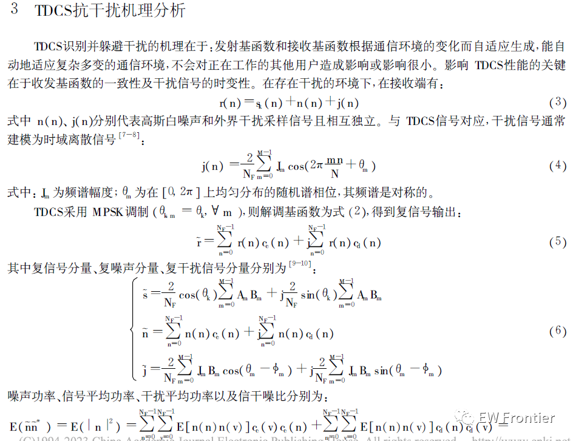
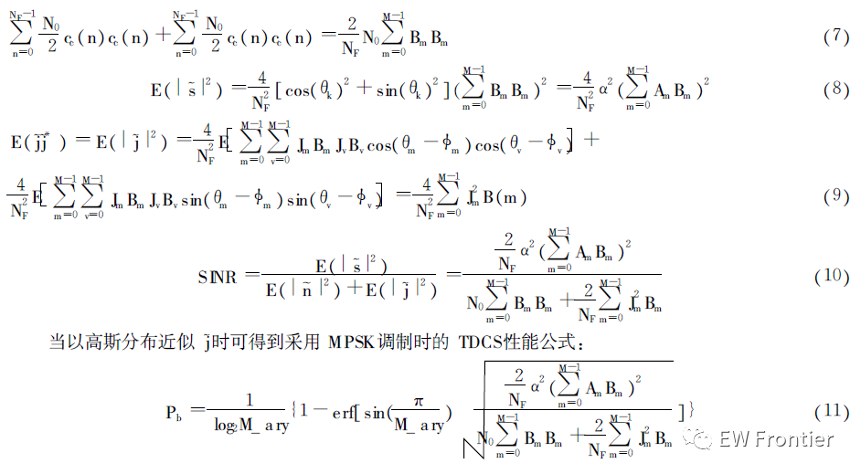
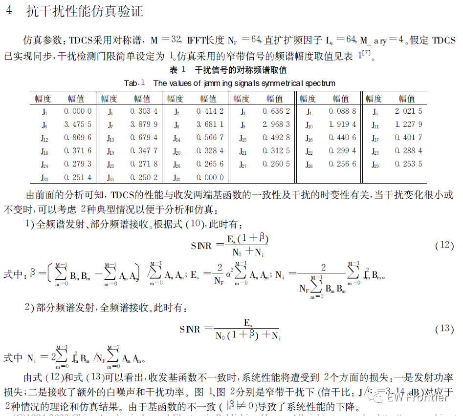
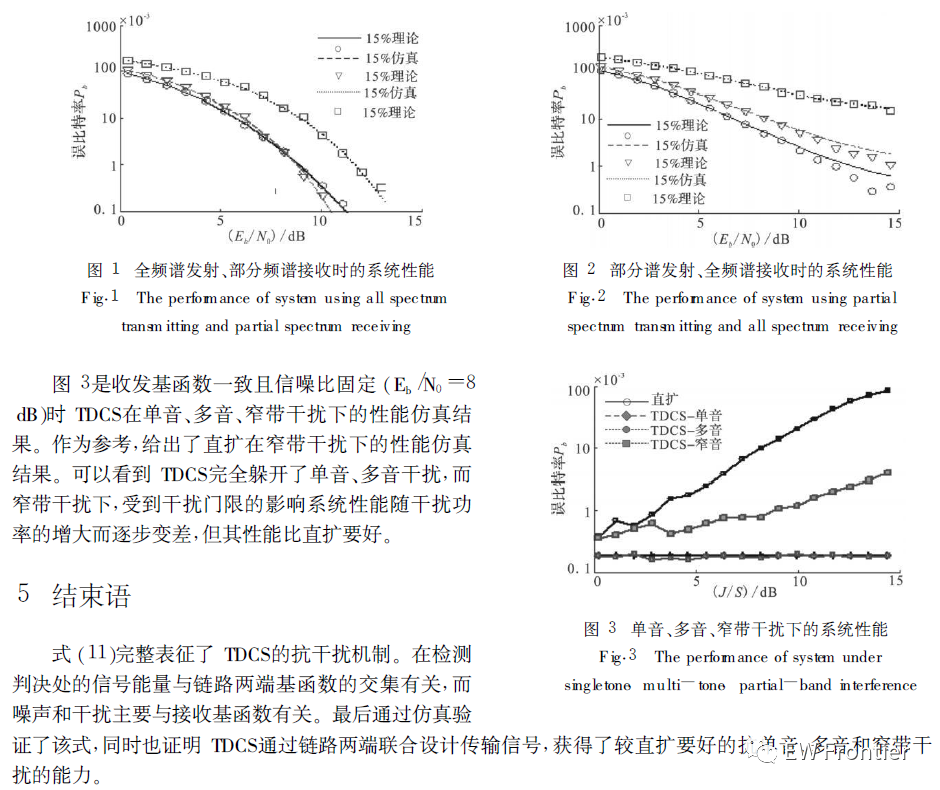

# [Anti-interference]Transform Domain Communication System (TDCS) and Anti-interference (Mono, Poly, Narrowband, Noise, etc.) Performance Simulation MATLAB Code

​  

## Images

<!-- PAYMENT_BLOCK -->

## Get this dataset

- Payment link (Stripe): [Buy now](https://buy.stripe.com/3cs8yP7sY87d0vu9AB)
- Payment QR code: 

<!-- /PAYMENT_BLOCK -->
